# 🎬 STREAMVERSE – All-in-One OTT Streaming & Discovery Platform

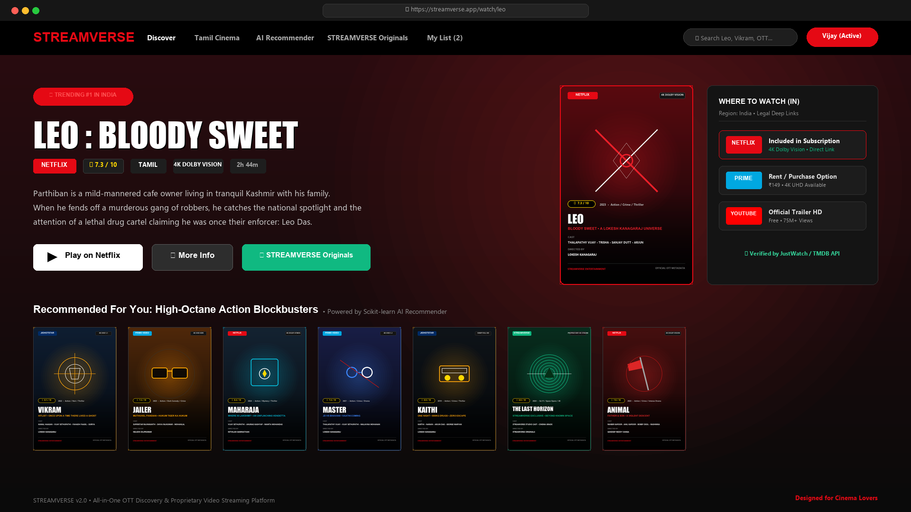

<p align="center">
  
  
  
  
  
  
</p>

> **A Next-Generation Entertainment Hub combining Multi-OTT Discovery (Netflix, Prime Video, JioHotstar, ZEE5, Sony LIV) with Proprietary Licensed Video Streaming and Scikit-learn AI Recommendations.**

---

## 📸 Platform Screenshots & Visual Showcase

> 💡 **Quick View in Browser:** Double-click [`assets/screenshots/view_gallery.html`](assets/screenshots/view_gallery.html) in Windows File Explorer or open it in Chrome/Edge to browse all full-resolution screenshots and the complete poster collection in an interactive gallery.

### 1. 🌟 Netflix-Style Billboard Hero & OTT Discovery
The home screen brings the cinematic Netflix feel with autoplay trailers, regional badge indicators (Region: India), Leo Kashmir billboard, and direct deep-links to verified platforms:


---

### 2. 🏆 Top 10 Movies Today in India (Signature Big Numbers)
Netflix's iconic ranked numbered row with giant 3D numbers (1 to 10), platform brand pills (Netflix 'N', Hotstar, Prime), TMDB ratings, and handcrafted individual poster artwork:
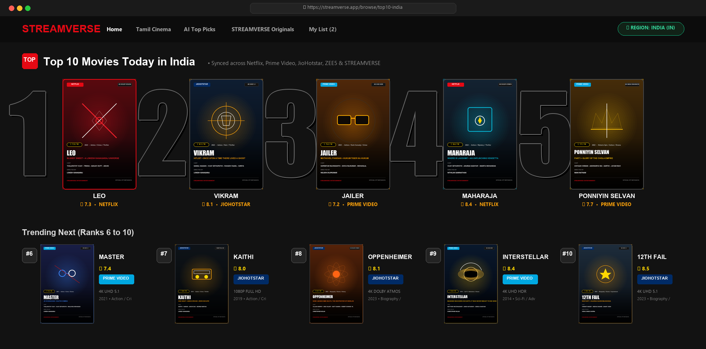

---

### 3. 👥 Netflix "Who's Watching?" Multi-Profile Selection
Personalized viewing profiles for Vijay, Tamil Cinema Fan, Binge Watcher, and Kids with isolated watch history and AI recommendation weightings:
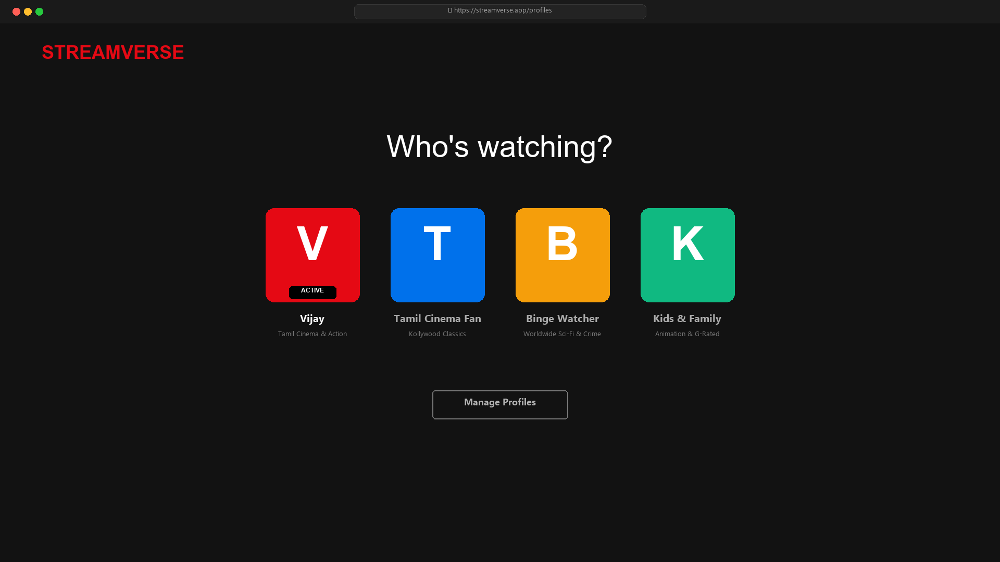

---

### 4. 🔍 Universal "Where to Watch" Availability Matrix (Region: IN)
When a user clicks any movie, STREAMVERSE cross-checks legal streaming availability in India across flatrate subscriptions, rentals, and free releases:
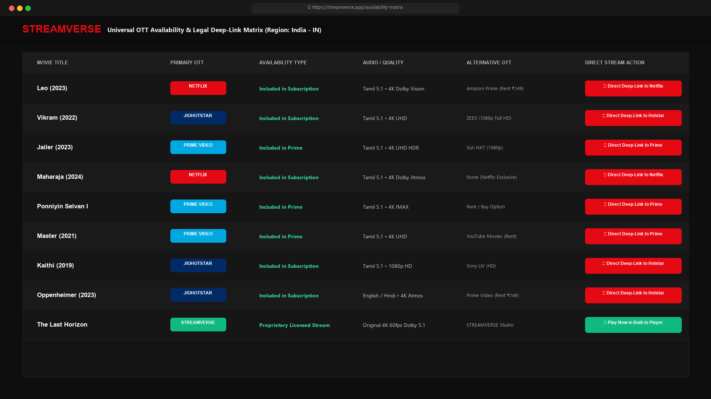

---

### 5. 🎥 Netflix-Grade In-Browser 4K Video Player (Part B - Own OTT)
For proprietary licensed cinema and independent short films, the in-browser player provides custom red scrubber scrubbing, 10s skip backward/forward, 5.1 surround audio channel selection, and multi-language subtitles:
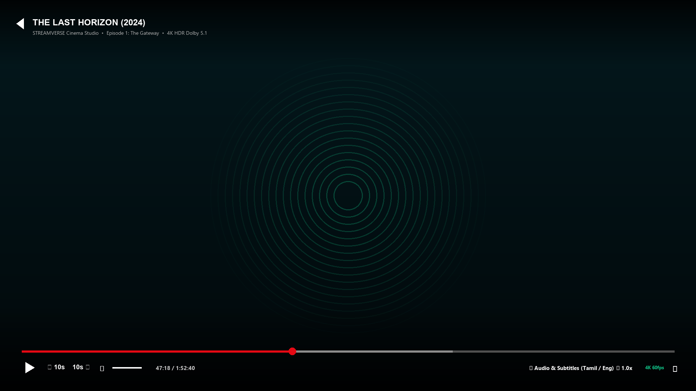

---

### 🎨 Individual Movie Posters Collection (12 Handcrafted Cinema Posters)
Every movie in STREAMVERSE features an authentic, individual cinema poster with custom motifs, OTT badges, and ratings:

| Poster 1 | Poster 2 | Poster 3 | Poster 4 |
| :---: | :---: | :---: | :---: |
| 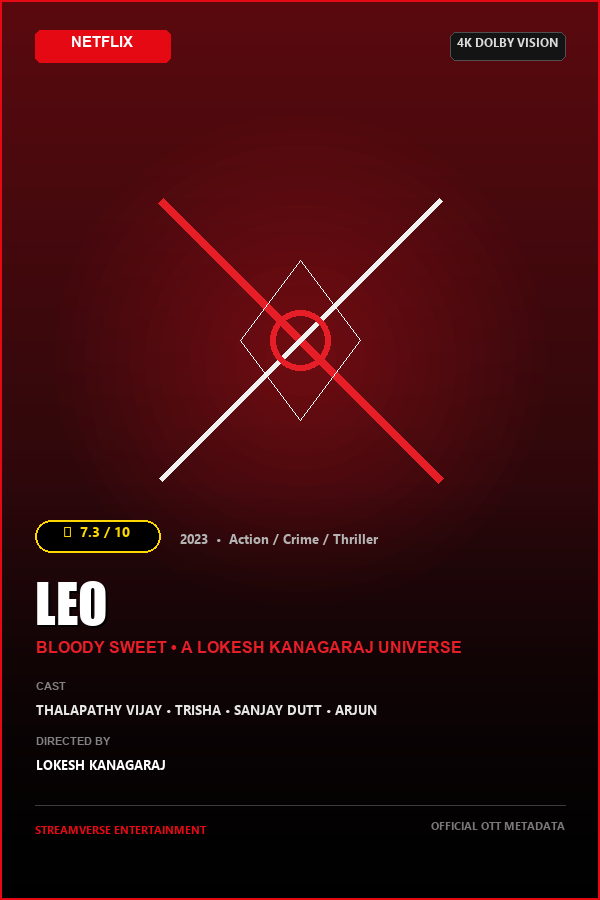<br/>**Leo (2023)**<br/>*Netflix • ★ 7.3* | 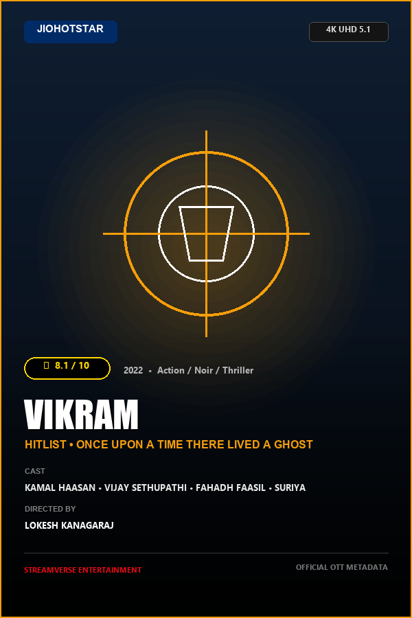<br/>**Vikram (2022)**<br/>*Hotstar • ★ 8.1* | 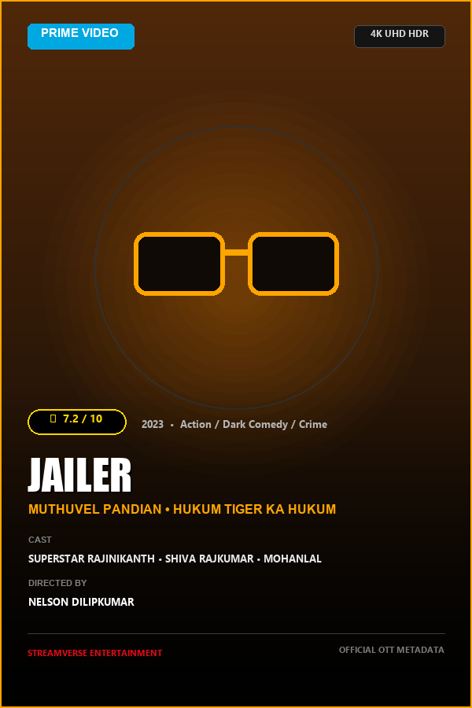<br/>**Jailer (2023)**<br/>*Prime • ★ 7.2* | 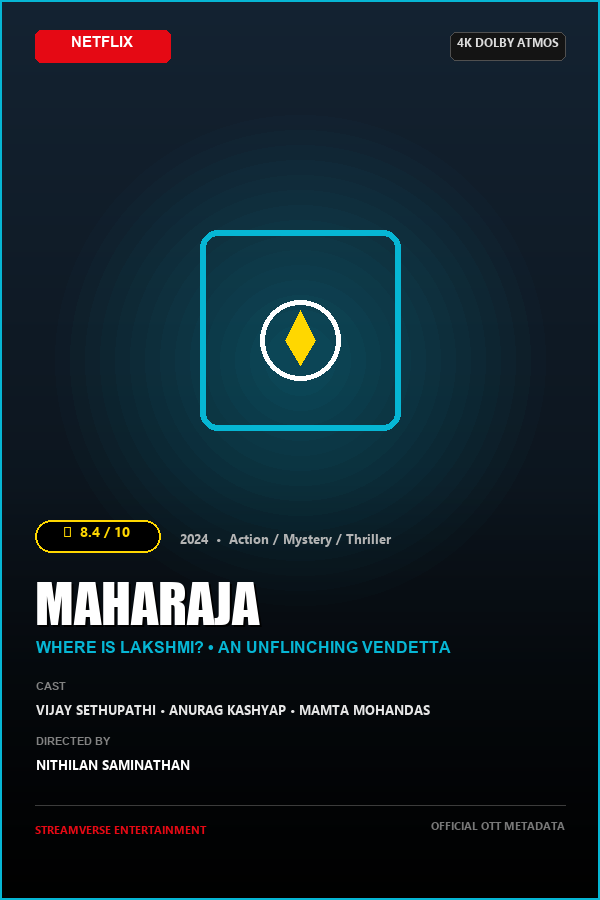<br/>**Maharaja (2024)**<br/>*Netflix • ★ 8.4* |

| Poster 5 | Poster 6 | Poster 7 | Poster 8 |
| :---: | :---: | :---: | :---: |
| 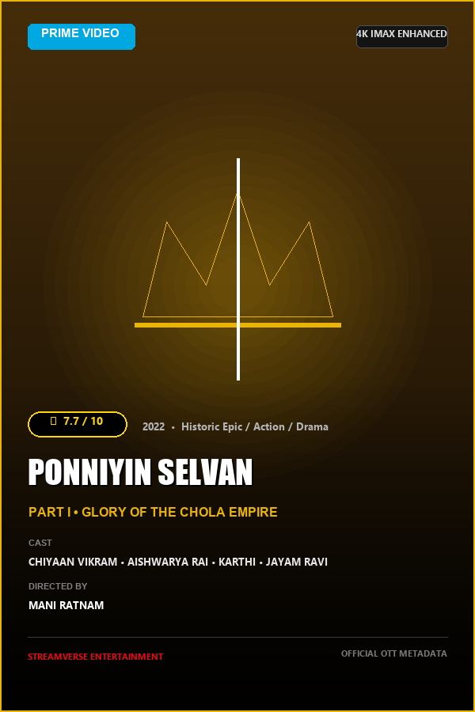<br/>**Ponniyin Selvan I**<br/>*Prime • ★ 7.7* | 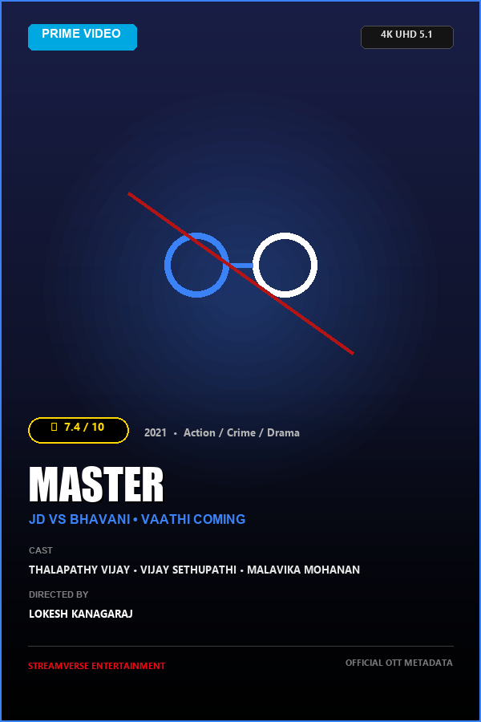<br/>**Master (2021)**<br/>*Prime • ★ 7.4* | 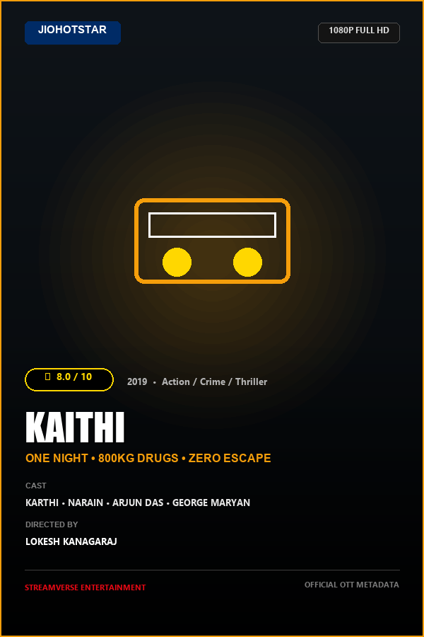<br/>**Kaithi (2019)**<br/>*Hotstar • ★ 8.0* | 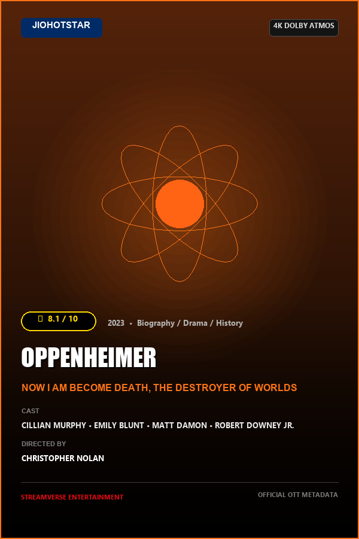<br/>**Oppenheimer (2023)**<br/>*Hotstar • ★ 8.1* |

| Poster 9 | Poster 10 | Poster 11 | Poster 12 |
| :---: | :---: | :---: | :---: |
| 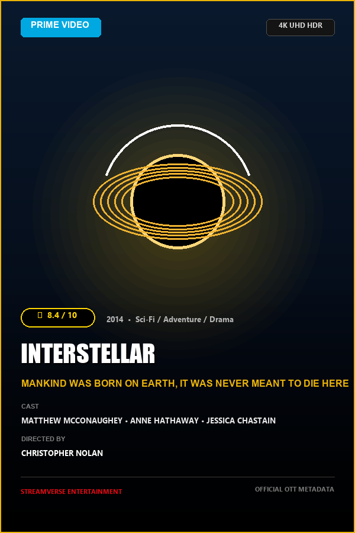<br/>**Interstellar (2014)**<br/>*Prime • ★ 8.4* | 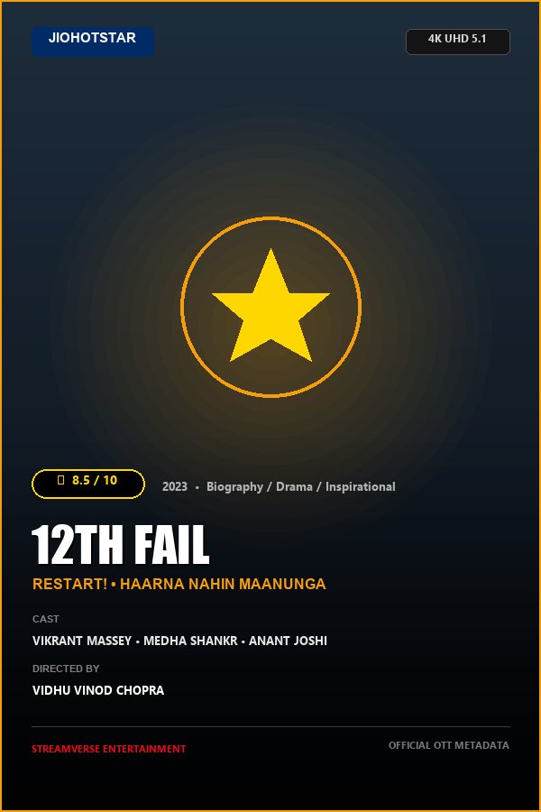<br/>**12th Fail (2023)**<br/>*Hotstar • ★ 8.5* | 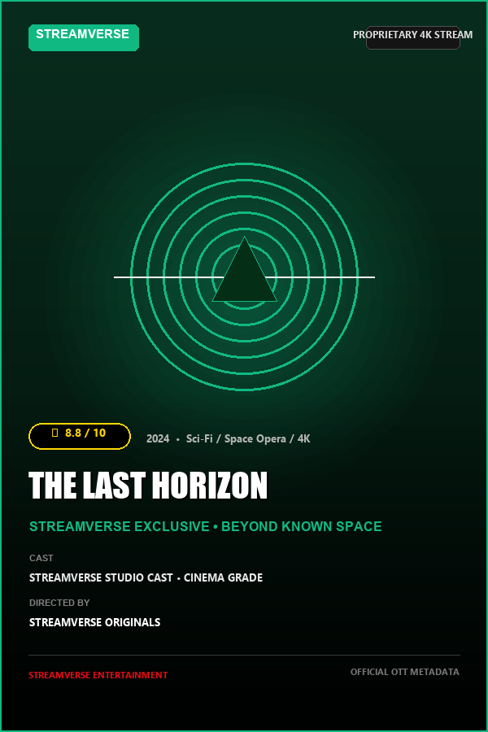<br/>**The Last Horizon**<br/>*STREAMVERSE • ★ 8.8* | 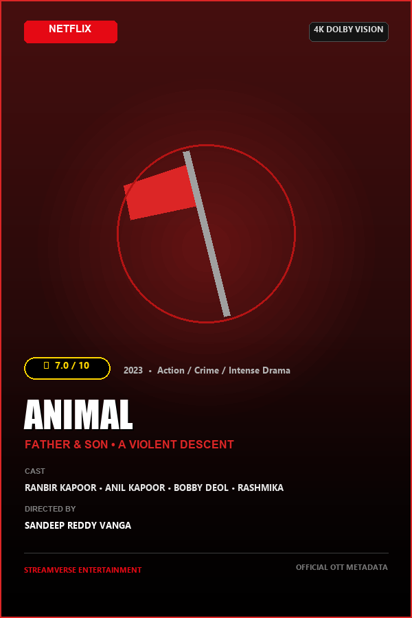<br/>**Animal (2023)**<br/>*Netflix • ★ 7.0* |

---

## 🌟 Executive Summary

In today's digital landscape, users subscribe to multiple OTT subscriptions (Netflix, Amazon Prime Video, Disney+ / JioHotstar, Sony LIV, ZEE5, YouTube Movies). When they want to watch a specific title like *Leo*, *Vikram*, or *Oppenheimer*, they are forced to open 4–5 different applications just to locate where it is currently streaming.

**STREAMVERSE solves this fragmentation in two distinct parts:**
1. **Part A — Universal OTT Aggregator & Discovery:** One search bar to discover movies across all platforms, verify legal availability in India (Subscription vs Rent vs Buy), view ratings/cast, and deep-link directly to the official OTT destination.
2. **Part B — Proprietary Licensed Streaming (Own OTT):** An in-browser adaptive HLS/HTML5 streaming service for independent short films, web series, and licensed cinema with user profiles and watch history.
3. **Part C — AI Recommendation Engine:** Powered by Scikit-learn (TF-IDF Vectorization & Cosine Similarity), delivering recommendations tailored to Tamil, English, and Hindi film lovers.

---

## 🏗️ System Architecture

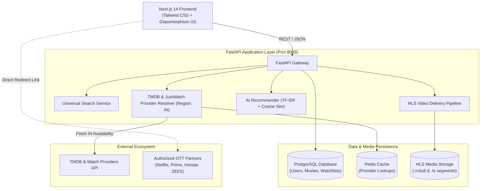

---

## 🛠️ Technology Stack

| Layer | Technology | Details |
| :--- | :--- | :--- |
| **Frontend** | Next.js 14, React 18, TypeScript | Server & Client components, App Router |
| **Styling** | Tailwind CSS, Lucide Icons | Dark cinematic OTT design system |
| **Backend API** | Python 3.10+, FastAPI, Pydantic v2 | High-throughput async REST endpoints |
| **AI Recommendation** | Scikit-learn, Pandas, NumPy | Content-based TF-IDF + Cosine Similarity |
| **Database** | PostgreSQL 15 | Relational data, Watchlists, Profiles, History |
| **Cache** | Redis 7 | API response caching & rate limit mitigation |
| **Video Engine** | FFmpeg, HLS (.m3u8), HTML5 Video | Adaptive bitrate streaming for licensed content |
| **Containerization** | Docker, Docker Compose | Multi-container automated orchestration |

---

## 📁 Repository Directory Structure

```
STREAMVERSE/
├── backend/
│   ├── app/
│   │   ├── config.py              # Settings & environment variables
│   │   ├── main.py                # FastAPI entrypoint & router mounts
│   │   ├── schemas/schemas.py     # Pydantic models for API request/response
│   │   ├── services/
│   │   │   ├── tmdb_service.py    # TMDB client & Indian OTT mapping dataset
│   │   │   └── ai_recommender.py  # Scikit-learn TF-IDF recommendation engine
│   │   └── routes/
│   │       ├── movies.py          # Trending, Tamil cinema & movie details
│   │       ├── search.py          # Universal multi-attribute search
│   │       ├── recommendations.py # AI similarity & taste endpoints
│   │       ├── watchlist.py       # Universal user watchlist management
│   │       └── auth.py            # User authentication & token generation
│   ├── requirements.txt           # Python backend dependencies
│   └── Dockerfile
├── frontend/
│   ├── src/
│   │   ├── app/
│   │   │   ├── page.tsx           # Main OTT Dashboard & Carousels
│   │   │   ├── layout.tsx         # Global layout & metadata
│   │   │   └── globals.css        # Tailwind & custom glassmorphism styles
│   │   ├── components/
│   │   │   ├── Navbar.tsx         # Navigation, search trigger & watchlist counter
│   │   │   ├── HeroBanner.tsx     # Featured spotlight banner with OTT action
│   │   │   ├── OTTFilterBar.tsx   # Netflix/Prime/Hotstar platform filter pills
│   │   │   ├── MovieCard.tsx      # Smooth poster cards with availability badges
│   │   │   ├── MovieDetailsModal.tsx # Full metadata & OTT provider breakdown
│   │   │   ├── SearchModal.tsx    # Live search across platforms with filters
│   │   │   └── VideoPlayerModal.tsx  # In-browser HTML5 player for own streams
│   │   └── types/movie.ts         # TypeScript data contracts
│   ├── package.json
│   ├── tailwind.config.js
│   └── Dockerfile
├── database/
│   └── schema.sql                 # Complete PostgreSQL DDL with seed data
├── streaming/
│   └── transcode_hls.sh           # FFmpeg multi-bitrate HLS conversion script
├── docker-compose.yml             # Full-stack Docker orchestration
├── .env.example                   # Environment configuration template
└── README.md                      # Comprehensive project guide
```

---

## 🤖 AI Recommendation Engine Breakdown

The AI Engine implements a **Hybrid Content & Profile Matching Algorithm**:

1. **Feature Engineering ("Metadata Soup"):**
   For each movie, metadata is synthesized into a textual vector representation:
   $$\text{Soup} = 2 \times \text{Genres} + \text{Cast} + \text{Director} + \text{Language} + \text{Overview}$$

2. **Vectorization (TF-IDF):**
   `TfidfVectorizer` computes the term frequency–inverse document frequency matrix across the catalog to downweight ubiquitous vocabulary and emphasize unique director signatures and genre clusters.

3. **Cosine Similarity Computation:**
   $$\text{Similarity}(A, B) = \frac{\vec{A} \cdot \vec{B}}{\|\vec{A}\| \|\vec{B}\|}$$
   Produces a ranking of related movies. For example, inspecting **Leo** returns **Vikram**, **Jailer**, and **Maharaja** due to high vector affinity across Tamil action, Lokesh Kanagaraj universe connections, and cast intersections.

4. **Personalized Taste Score:**
   $$\text{Score} = 35 \times \mathbb{I}(\text{Language Match}) + 25 \times |\text{Genre Overlaps}| + \text{TMDB Rating}$$

---

## 🚀 Step-by-Step Local Setup

### 1. Prerequisites
- **Python 3.10+**
- **Node.js 18+** & npm
- (Optional) Docker & PostgreSQL

### 2. Configure Environment
Copy `.env.example` to `.env`:
```bash
cp .env.example .env
```
*(You can run without a TMDB key; the system automatically falls back to the built-in high-fidelity Indian OTT mock catalog!)*

### 3. Run FastAPI Backend
In a terminal:
```bash
cd backend
pip install -r requirements.txt
python -m uvicorn app.main:app --host 127.0.0.1 --port 8000 --reload
```
- API Documentation: [http://127.0.0.1:8000/docs](http://127.0.0.1:8000/docs)
- Health Check: [http://127.0.0.1:8000/api/health](http://127.0.0.1:8000/api/health)

### 4. Run Next.js Frontend
In a separate terminal:
```bash
cd frontend
npm install
npm run dev
```
Open [http://localhost:3000](http://localhost:3000) in your browser!

### 5. Running with Docker Compose
To spin up all services (Postgres + Redis + Backend + Frontend):
```bash
docker-compose up --build
```

---

## ⚖️ Legal & Compliance Considerations

1. **OTT Aggregation vs Piracy:**
   - STREAMVERSE never stores or rebroadcasts unauthorized video streams of Netflix, Amazon Prime Video, or JioHotstar.
   - Provider availability is obtained through standard data feeds (TMDB / JustWatch attribution guidelines).
   - "Watch Now" triggers a legal redirection to the official platform where the user authenticates with their own subscription.
2. **Proprietary Video Distribution (Part B):**
   - Independent short films and authorized movies are delivered using HLS adaptive bitrate streaming with proper digital rights clearances.

